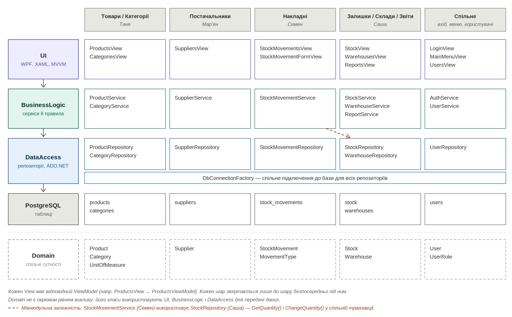
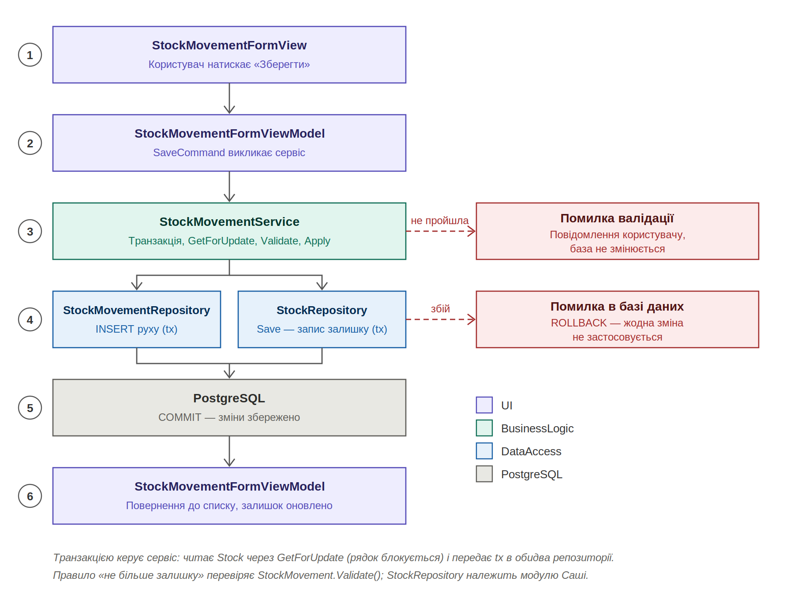
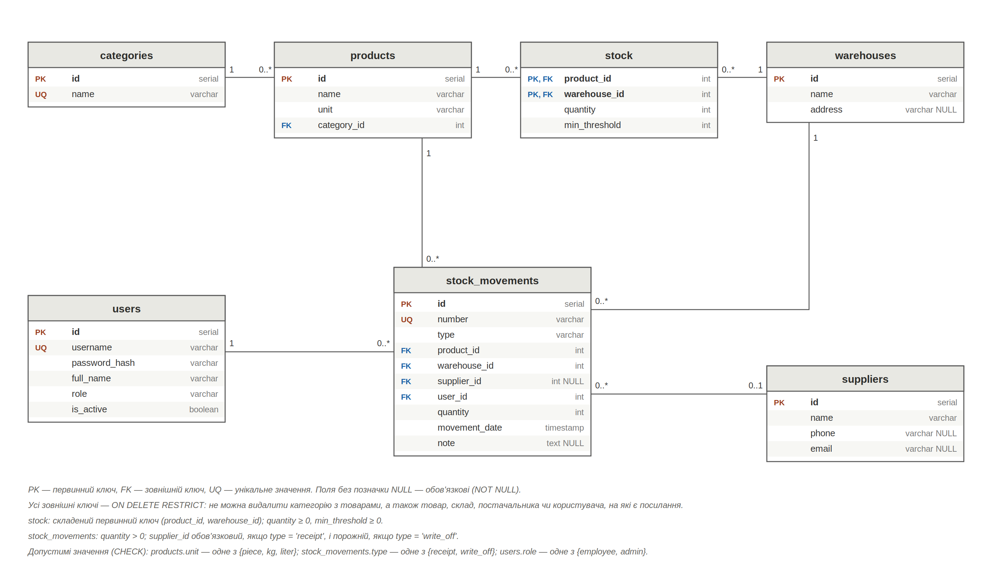

# Архітектура StockFlow

## 1. Архітектурний підхід

StockFlow побудовано за **шаровою (layered) архітектурою**. Застосунок поділено на шари, кожен з яких має чітку відповідальність і звертається лише до шару безпосередньо під ним:

**UI → BusinessLogic → DataAccess → PostgreSQL**

Окремо існує шар **Domain** — спільні класи-сутності, якими користуються всі три шари коду для передачі даних.

Усередині UI-шару використовується патерн **MVVM** (Model–View–ViewModel), стандартний для WPF: розмітка екрана (View, XAML) відокремлена від логіки відображення (ViewModel), а зв'язок між ними відбувається через data binding і команди.

Обґрунтування вибору наведено в розділі 6.

## 2. Структура рішення

Реальний каркас використовує .NET 8 і містить саме `StockFlow.sln` (не `.slnx`).
`global.json` обирає стабільний SDK 8.0.4xx або новіший feature band .NET 8.

```text
StockFlow.sln
global.json
src/
  StockFlow.Domain/
    StockFlow.Domain.csproj          # net8.0, незалежна модель
    MovementType.cs                 # Receipt / WriteOff
  StockFlow.DataAccess/
    StockFlow.DataAccess.csproj      # net8.0, ADO.NET / Npgsql
    DbConnectionFactory.cs          # нове закрите з'єднання на кожну операцію
  StockFlow.BusinessLogic/
    StockFlow.BusinessLogic.csproj   # net8.0, майбутні сервіси
    ServiceCollectionExtensions.cs  # AddStockFlow: межа реєстрації DI
    StockFlowConfiguration.cs       # JSON біля executable + STOCKFLOW_ environment
  StockFlow.UI/
    StockFlow.UI.csproj             # net8.0-windows, UseWPF=true
    App.xaml / App.xaml.cs          # виклик BusinessLogic для конфігурації й DI
    MainWindow.xaml / .xaml.cs       # стандартне порожнє вікно
    appsettings.example.json        # лише безпечний приклад; не завантажується
    appsettings.json                # тільки локально, ігнорується Git
tests/
  StockFlow.Tests/
    StockFlow.Tests.csproj          # net8.0, xUnit, без WPF і PostgreSQL
    DbConnectionFactoryTests.cs
    StockFlowConfigurationTests.cs
documentation/
  architecture.md
  stage5-integration.md             # контракти, перевірки й залежності команди
  diagrams/                        # актуальні UML та ER
```

Фактичні **прямі** `ProjectReference`:

| Проєкт | Посилається на |
|---|---|
| Domain | жоден проєкт |
| DataAccess | Domain |
| BusinessLogic | Domain, DataAccess |
| UI | BusinessLogic, Domain |
| Tests | Domain, BusinessLogic, DataAccess |

`DisableTransitiveProjectReferences=true` у UI забороняє доступ до публічних
типів DataAccess через BusinessLogic. `EnableWindowsTargeting=true` тільки в UI
дозволяє cross-build на macOS; запуск WPF потребує Windows. Tests не посилається
на UI. Domain не містить Npgsql, WPF, DI чи пакетів конфігурації.

Npgsql 8.0.9 використовується в DataAccess; CommunityToolkit.Mvvm 8.4.2 — у UI.
Tests використовує xUnit 2.9.3, runner 3.1.5 і Microsoft.NET.Test.Sdk 17.14.1.
Компоненти Microsoft.Extensions 8.0.x додані лише до проєктів, які їх використовують.

`DbConnectionFactory` читає `ConnectionStrings:StockFlow`, перевіряє синтаксис
без доступу до сервера та створює **закриті незалежні** підключення. Фабрика
реєструється ліниво як singleton, але connection ніколи не є singleton.
Споживач відкриває підключення для операції й виконує `Dispose`/`DisposeAsync`.
Сервіс керує спільною транзакцією; фабрика її не створює й не фіксує.

Конфігурація читається з `AppContext.BaseDirectory`, незалежно від поточної
директорії термінала. Змінна `STOCKFLOW_ConnectionStrings__StockFlow` перевизначає
JSON. `appsettings.example.json` ніколи не використовується як конфігурація
з'єднання. Локальний `appsettings.json` копіюється у build/publish output лише
за наявності; чиста копія збирається без нього. Без рядка підключення DI та
мінімальне вікно можуть бути створені; перше отримання фабрики дає зрозумілу
помилку без пароля. Некоректний JSON також дає очищену від вмісту файлу помилку.

**Реалізовано:** каркас, фабрика, конфігурація, реєстрація DI, `MovementType`
та юніт-тести інфраструктури. Через PR #124 у main додані спільні `Stock`,
`Warehouse`, початковий `IStockRepository` та UI-оболонка Саші. `StockMovement`
і його тести ще не входять до main на час цієї звірки. Уточнений контракт
залишків описано нижче й у [пропозиції етапу 6](stock-contract.md).
Production-заглушки й альтернативного типу Stock немає.

**Залишається команді:** Саша — реалізація `StockRepository` і функціональні
екрани поверх уже доданих оболонки, навігації та теми; Мар'ян — CI поверх
уже доданих через PR #123 SQL-схеми/seed, користувачів, постачальників і
контексту; Таня — наскрізний зріз поверх наявних Product/Category та загальний
README. Додавання сутностей не означає готовність усіх репозиторіїв і екранів.
Інші розділи цього документа описують цільову архітектуру.

## 3. Основні компоненти та їх відповідальність



### UI (WPF, XAML, MVVM)

Екрани застосунку та їхні ViewModels. Кожен View має відповідний ViewModel (наприклад, `ProductsView` ↔ `ProductsViewModel`).

- **Відповідає за:** відображення даних, реакцію на дії користувача, показ повідомлень про помилки, приховування елементів відповідно до ролі.
- **Не містить:** SQL-запитів і бізнес-правил.

### BusinessLogic

Сервіси, згруповані за модулями: `ProductService`, `CategoryService`, `SupplierService`, `StockMovementService`, `StockService`, `WarehouseService`, `ReportService`, `AuthService`, `UserService`.

- **Відповідає за:** бізнес-правила та валідацію (обов'язкові поля, унікальність назви категорії, заборона списання понад залишок, перевірка ролі), керування транзакціями.
- **Не містить:** SQL-запитів і звернень до елементів інтерфейсу.

### DataAccess

Репозиторії на ADO.NET: `ProductRepository`, `CategoryRepository`, `SupplierRepository`, `StockMovementRepository`, `StockRepository`, `WarehouseRepository`, `UserRepository`, а також спільний `DbConnectionFactory`, через який усі репозиторії отримують підключення до бази.

- **Відповідає за:** читання й запис даних у PostgreSQL. Усі запити параметризовані.
- **Не містить:** бізнес-правил і повідомлень для користувача.

### PostgreSQL

Реляційна база даних із таблицями `products`, `categories`, `suppliers`, `warehouses`, `stock`, `stock_movements`, `users`.

### Domain

Класи-сутності (`Product`, `Category`, `Supplier`, `Warehouse`, `Stock`, `StockMovement`, `User`) і переліки (`UnitOfMeasure`, `MovementType`, `UserRole`). Не залежить від жодного іншого шару.

### Розподіл модулів у команді

| Модуль | Відповідальний |
|---|---|
| Товари / Категорії | Таня |
| Постачальники | Мар'ян |
| Накладні (рух товару) | Семен |
| Залишки / Склади / Звіти | Саша |
| Спільне: вхід, головне меню, користувачі | — |

## 4. Взаємодія компонентів

Нижче показано, як через шари проходить найважливіша дія системи — збереження накладної (руху товару).



1. Користувач заповнює форму в `StockMovementFormView` і натискає «Зберегти».
2. `StockMovementFormViewModel` через команду `SaveCommand` передає дані форми в `StockMovementService`.
3. `StockMovementService` перевіряє роль користувача й обов'язкові поля. Якщо перевірка не пройдена, користувач бачить повідомлення про помилку, а база даних не змінюється. Після успішної перевірки сервіс відкриває `IDbTransaction` і читає залишок через `StockRepository.GetForUpdate()`. Якщо запис існує, його рядок блокується до кінця транзакції.
4. `StockMovement.Validate(stock)` перевіряє достатність товару для `WriteOff`; для `Receipt` нестача товару не є причиною відмови. `StockMovement.Apply(stock)` змінює кількість в об'єкті `Stock`. Сервіс передає ту саму транзакцію в обидва репозиторії: `StockMovementRepository` додає запис руху товару, а `StockRepository.Save(stock)` зберігає залишок для пари (товар, склад). Репозиторії одне одного не викликають — транзакцією керує лише сервіс.
5. Якщо обидві операції успішні, транзакція фіксується (`COMMIT`). Якщо перевірка або будь-яка операція в транзакції завершується помилкою, усі зміни відкочуються (`ROLLBACK`).
6. Результат повертається у ViewModel: користувач повертається до списку накладних, а оновлений залишок одразу доступний у вікні «Залишки».

Ця схема забезпечує дві нефункціональні вимоги:

- **Надійність:** рух товару і залишок змінюються атомарно — разом або не змінюються взагалі.
- **Безпека:** SQL існує лише в шарі DataAccess і завжди параметризований.

Детальний перебіг надходження описано в [сценарії реєстрації надходження товару](scenarios.md#сценарій-реєстрація-надходження-товару).

### Міжмодульна залежність: Накладні → Залишки

`StockMovementService` (модуль «Накладні», Семен) використовує `StockRepository` (модуль «Залишки», Саша): у спільній транзакції отримує залишок через `GetForUpdate()`, перевіряє рух, змінює об'єкт `Stock` через `StockMovement.Apply(stock)` і передає його на збереження. Наявний рядок залишку блокується до завершення транзакції. На схемі шарів ця залежність позначена пунктирною стрілкою.

Для інтеграції підготовлено **пропозицію** синхронного контракту
`StockFlow.DataAccess.IStockRepository`; це ще не підтвердження погодження зі Сашею.
Єдиний тип залишку — `StockFlow.Domain.Stock`. Після PR #124 спільний `Stock`
та два транзакційні методи інтерфейсу вже є в main.
У цьому PR до інтерфейсу додано відсутній `GetAll(int? warehouseId)`; підтвердження
повної поведінки Сашею та реалізація `StockRepository` ще очікуються.

| Метод | Призначення й володіння ресурсами |
|---|---|
| `Stock GetForUpdate(int productId, int warehouseId, IDbTransaction transaction)` | Читає залишок пари через `SELECT ... FOR UPDATE`, блокуючи лише наявний рядок. Якщо рядка немає, повертає новий `Stock` із тими ж ProductId/WarehouseId, Quantity=0 і MinThreshold=0. Використовує підключення переданої транзакції й не закриває його. |
| `void Save(Stock stock, IDbTransaction transaction)` | На тому самому підключенні виконує `INSERT ... ON CONFLICT (product_id, warehouse_id) DO UPDATE SET quantity = EXCLUDED.quantity`. Для нового рядка поріг 0; при оновленні `min_threshold` зберігається. Не відкриває друге підключення, не робить commit/rollback і не звільняє передану транзакцію. |
| `IReadOnlyList<Stock> GetAll(int? warehouseId)` | Повертає матеріалізований список залишків: null — усі склади, інакше фільтр за складом. Параметра транзакції немає; для цього окремого читання репозиторій сам відкриває та звільняє підключення. |

`IDbTransaction` — `System.Data.IDbTransaction`. Сервіс володіє підключенням,
спільною транзакцією, commit/rollback і Dispose. `GetForUpdate` та `Save` не
викликають один одного. `GetAll` не використовується замість транзакційного
читання залишку при реєстрації руху.

`SELECT FOR UPDATE` не блокує відсутній рядок. UPSERT із присвоєнням уже
обчисленої кількості сам по собі може втратити паралельне збільшення. Для
SE-9 запропоновано **Serializable для всієї операції Register** і відкат усієї
транзакції при SQLSTATE `40001`, після чого користувачу — «Спробуйте ще раз».
Автоматичного повтору, який непомітно зробить обидва перші надходження успішними,
ця пропозиція не передбачає. `23505` потрібно розрізняти за constraint; це не
універсальна ознака конкурентного конфлікту. Стратегія очікує підтвердження
Саші/Мар'яна й окремої перевірки на тестовій PostgreSQL з відтворюваним
перекриттям транзакцій. Подробиці та точні питання — у
[контракті етапу 6](stock-contract.md).

## 5. Модель даних



Ключові рішення моделі даних:

- **Залишки** зберігаються в `stock` для кожної пари (товар, склад). Там само зберігається мінімальна норма `min_threshold`, бо вона може відрізнятися для різних складів.
- **Накладна** — один запис у `stock_movements` (одна дія з одним товаром). Тип руху (`receipt` / `write_off`) — поле таблиці, а не окрема сутність. Постачальник вказується лише для надходження.
- **Ролі** — поле `role` у таблиці `users` (`employee` / `admin`). Окрема таблиця ролей не потрібна, бо ролей лише дві.
- **Одиниця виміру** — поле `unit` у `products` з фіксованим набором значень.
- **Видалення** обмежене на рівні бази: усі зовнішні ключі мають правило `ON DELETE RESTRICT`. Зокрема, категорію неможливо видалити, поки в ній є товари, а товар, склад, постачальника чи користувача — поки на них посилаються залишки або накладні. Так історія руху товару ніколи не втрачається.

## 6. Обґрунтування ключових рішень

### Шарова архітектура і MVVM

Шарову архітектуру обрано, бо вона:

- дозволяє кожному учаснику команди працювати над своїм модулем наскрізно (від таблиці до екрана), не заважаючи іншим;
- ізолює SQL в одному шарі, що спрощує захист від SQL-ін'єкцій;
- дає змогу тестувати бізнес-правила (наприклад, заборону списання понад залишок) автоматизованими тестами без запуску інтерфейсу.

MVVM у UI-шарі обрано, бо:

- ViewModel — звичайний клас без вікна, тож логіку екранів можна покрити тестами xUnit;
- видимість елементів залежно від ролі користувача задається властивістю ViewModel і прив'язується до інтерфейсу, а не прописується вручну в кожному вікні;
- бізнес-логіка не потрапляє в code-behind вікон, що зберігає межі між шарами.

### Правила залишку в сутностях і блокування рядка

Правило «не можна списати більше, ніж є на складі» реалізовано в сутності `StockMovement` (методи `Validate(stock)` і `Apply(stock)`), а не в SQL чи сервісі. Так його можна перевірити звичайним юніт-тестом без бази даних і заглушок, а стиль збігається з рештою сутностей (наприклад, `Stock.IsBelowThreshold()`).

Оскільки залишок спершу читається, а потім записується, паралельні рухи потребують спільної транзакції. `StockRepository.GetForUpdate()` має читати наявний рядок через `SELECT ... FOR UPDATE` і утримувати блокування до завершення транзакції. За Read Committed конкурентний читач після очікування може отримати оновлений рядок; за запропонованого для етапу 6 Serializable конкурентна операція може завершитися SQLSTATE `40001` і потребувати повтору всієї операції. Відсутній рядок цей SELECT не блокує: перше надходження окремо охоплене [пропозицією контракту](stock-contract.md). Обмеження `CHECK (quantity >= 0)` додатково захищає невід'ємність, але не замінює захист від втрати паралельного збільшення.

### Об'єднання ролей Працівник і Власник

У StockFlow ролі Працівник і Власник об’єднано в одну роль **Працівник (`Employee`)**, оскільки в межах поточних вимог їхні можливості збігаються: перегляд і пошук даних, перегляд залишків та звітів, реєстрація надходження і списання товару. Посада власника сама по собі не потребує окремої ролі доступу, якщо набір дозволених дій залишається таким самим.

Таке рішення зменшує дублювання перевірок прав, спрощує інтерфейс і скорочує кількість тестових сценаріїв. У моделі залишаються дві ролі: `Employee` та `Admin`, які зберігаються в полі `role` таблиці `users` як `employee` та `admin`.

**Адміністратор (`Admin`)** відповідає за керування довідниками, обліковими записами та призначення ролей. Він може переглядати рух товару, залишки й звіти, але не реєструє надходження та списання. Отже, права адміністратора і працівника визначаються окремо для кожної операції.

Доступність кнопок і розділів налаштовується в UI, а перевірка дозволу на виконання захищених операцій здійснюється в `BusinessLogic`.

Обмеження рішення — відсутність окремого набору прав для власника. Якщо надалі йому знадобляться специфічні можливості, модель доступу можна розширити, узгоджено оновивши `UserRole`, допустимі значення в БД, перевірки прав та інтерфейс.

### ADO.NET замість Entity Framework

ADO.NET передбачено вимогами курсу. У межах навчального проєкту явні параметризовані SQL-запити допомагають побачити, як застосунок звертається до PostgreSQL і як контролюється доступ до даних. У шарі `DataAccess` підключення надає `DbConnectionFactory`, а репозиторії виконують запити; бізнес-правила залишаються в `BusinessLogic`, відображення даних — у WPF-інтерфейсі.

Для реєстрації руху товару `StockMovementService` керує спільною `IDbTransaction`: після `GetForUpdate()` і `StockMovement.Apply(stock)` репозиторії зберігають рух та змінений `Stock`. Якщо перевірка або запис у транзакції завершується помилкою, вона відкочується, тому рух і залишок не можуть бути збережені частково. Межа транзакції та послідовність дій залишаються явними в коді.

Entity Framework також підтримує транзакції та міг би зменшити обсяг коду для роботи з даними. Проте для поточного обсягу StockFlow команда обрала ADO.NET, щоб безпосередньо опрацювати SQL, параметри запитів і взаємодію з PostgreSQL. Недолік цього рішення — SQL-запити та перетворення рядків результату на об’єкти потрібно писати й підтримувати вручну.

### Спрощена модель накладної (один запис = одна дія)

У StockFlow один запис `StockMovement` відповідає одній дії над одним товаром: надходженню (`Receipt`) або списанню (`WriteOff`). Запис містить тип руху, товар, кількість, склад, дату й користувача, який виконав дію. Для надходження також зазначається постачальник. Тип руху є полем `StockMovement`, а не окремою сутністю, що відповідає прийнятій ER-моделі.

Для поточних вимог така структура простіша за модель «шапка накладної + рядки»: не потрібно створювати окремі сутності для документа та його позицій. Форма зберігає одну дію, а `StockMovementService` може перевірити її дані, записати рух і змінити залишок відповідного товару на складі в одній транзакції. Кожен рух також можна окремо переглянути й врахувати у звітах.

Обмеження моделі полягає в тому, що поставку з кількома товарами доведеться зареєструвати кількома записами `StockMovement`; ці записи не будуть об’єднані в одну накладну. Якщо в майбутньому з’явиться вимога оформлювати один документ із багатьма товарними позиціями, модель можна розширити сутністю накладної та пов’язаними з нею рядками.

### PostgreSQL як СУБД

PostgreSQL обрано як СУБД проєкту, бо вона:

- забезпечує повну відповідність вимогам ACID і гарантує атомарність оновлення залишків та руху товарів у межах однієї транзакції;
- використовує механізм MVCC (Multi-Version Concurrency Control), що гарантує надійну ізоляцію рівня `READ COMMITTED` без блокування читання під час запису;
- дозволяє винести контроль цілісності даних на рівень ядра БД через обмеження `CHECK (quantity >= 0)`, `UNIQUE` та зовнішні ключі з правилом `ON DELETE RESTRICT`;
- ефективно виконує агрегатні запити (`SUM`, `COUNT`, `GROUP BY`) та фільтрацію за діапазонами дат, що критично для швидкодії модуля «Звіти»;
- має нативний високопродуктивний ADO.NET-провайдер для .NET (`Npgsql`), який підтримує повну параметризацію запитів і вбудоване керування пулом підключень;
- є відкритою системою з вільною ліцензією (PostgreSQL License) і легко розгортається локально або в Docker-контейнерах.