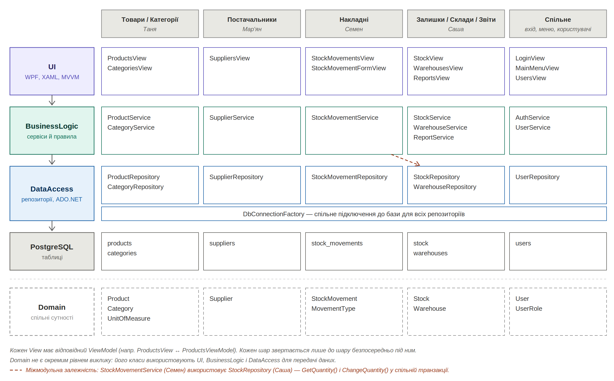
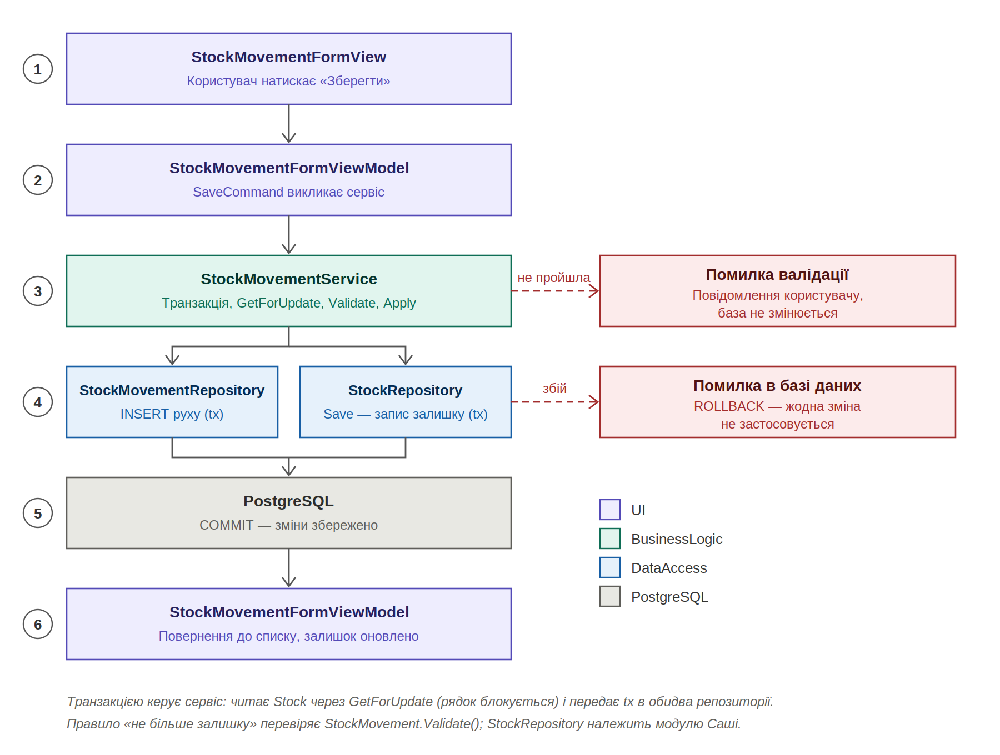
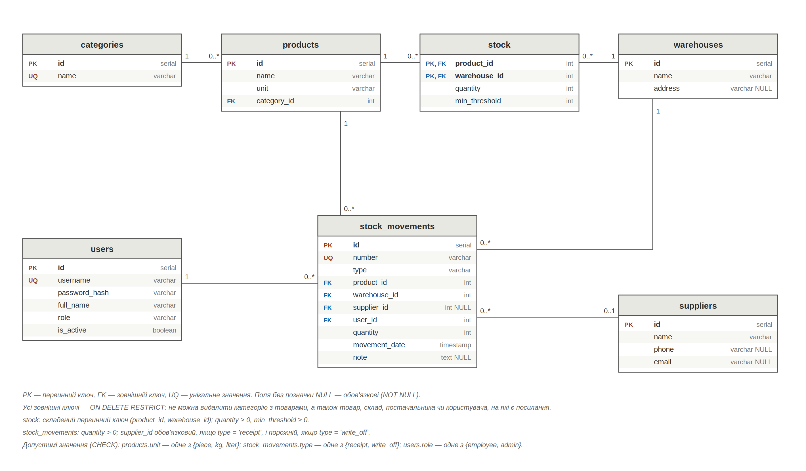

# Архітектура StockFlow

## 1. Архітектурний підхід

StockFlow побудовано за **шаровою (layered) архітектурою**. Застосунок поділено на шари, кожен з яких має чітку відповідальність і звертається лише до шару безпосередньо під ним:

**UI → BusinessLogic → DataAccess → PostgreSQL**

Окремо існує шар **Domain** — спільні класи-сутності, якими користуються всі три шари коду для передачі даних.

Усередині UI-шару використовується патерн **MVVM** (Model–View–ViewModel), стандартний для WPF: розмітка екрана (View, XAML) відокремлена від логіки відображення (ViewModel), а зв'язок між ними відбувається через data binding і команди.

Обґрунтування вибору наведено в розділі 6.

## 2. Структура рішення

Реальний каркас використовує .NET 8 і містить саме `StockFlow.sln` (не `.slnx`).
`global.json` обирає стабільний SDK 8.0.4xx або новіший feature band .NET 8.

```text
StockFlow.sln
global.json
.github/workflows/ci.yml            # build-and-test, database-checks, windows-checks
database/
  01_schema.sql                     # таблиці, ключі, ON DELETE RESTRICT, CHECK
  02_seed.sql                       # тестові користувачі, довідники, залишки
scripts/
  Verify-Isolated.ps1               # тимчасовий кластер для DatabaseChecks і WindowsChecks
  Verify-Movements-Isolated.sh      # тимчасовий кластер для MovementChecks
src/
  StockFlow.Domain/                 # net8.0, незалежна модель
    Product.cs, Category.cs, UnitOfMeasure.cs
    Supplier.cs, User.cs, UserRole.cs
    Stock.cs, Warehouse.cs, MovementType.cs
  StockFlow.DataAccess/             # net8.0, ADO.NET / Npgsql
    DbConnectionFactory.cs          # нове закрите з'єднання на кожну операцію
    IStockRepository.cs             # контракт залишків (модуль Саші)
    Products/                       # CategoryRepository, ProductRepository, UnitOfMeasureColumn
    Suppliers/                      # SupplierRepository
  StockFlow.BusinessLogic/          # net8.0, сервіси й правила
    ServiceCollectionExtensions.cs  # AddStockFlow: межа реєстрації DI
    StockFlowConfiguration.cs       # JSON біля executable + STOCKFLOW_ environment
    Products/                       # CategoryService, ProductService, ValidationException
    Suppliers/                      # SupplierService
    Users/                          # ICurrentUserContext, TemporaryUserContext
  StockFlow.UI/                     # net8.0-windows, WPF, MVVM
    App.xaml / App.xaml.cs          # конфігурація, AddStockFlow, DI екранів
    Services/                       # NavigationService
    Styles/Theme.xaml               # кольори, кнопки, таблиці
    ViewModels/                     # MainWindowViewModel, ProductsViewModel, CategoriesViewModel, SuppliersViewModel, ...
    Views/                          # MainWindow, ProductsView, CategoriesView, SuppliersView, екрани-заглушки
    appsettings.example.json        # лише безпечний приклад; не завантажується
    appsettings.json                # тільки локально, ігнорується Git
tests/
  StockFlow.Tests/                  # net8.0, xUnit, без WPF і PostgreSQL
    *Tests.cs                       # домен, сервіси з фейковими репозиторіями, DI, конфігурація
  StockFlow.DatabaseChecks/         # net8.0, репозиторії й обмеження схеми на PostgreSQL
  StockFlow.WindowsChecks/          # net8.0-windows, ViewModels і XAML екранів
  StockFlow.MovementChecks/         # net8.0, запити списку накладних на PostgreSQL
documentation/
  architecture.md
  testing-strategy.md               # рівні тестування, угоди, крайові ситуації
  requirements.md, user-stories.md, scenarios.md
  stage5-integration.md             # контракти, перевірки й залежності команди
  diagrams/                         # актуальні UML та ER
```

Модулі в DataAccess і BusinessLogic лежать у власних папках (`Products/`, `Suppliers/`, `Users/`).
В UI екрани розкладено за типом: `Views/` і `ViewModels/`; новий екран реєструється
в `App.xaml.cs` (ViewModel у DI) і в `MainWindow.xaml` (DataTemplate).

Фактичні **прямі** `ProjectReference`:

| Проєкт | Посилається на |
|---|---|
| Domain | жоден проєкт |
| DataAccess | Domain |
| BusinessLogic | Domain, DataAccess |
| UI | BusinessLogic, Domain |
| Tests | Domain, BusinessLogic, DataAccess |
| DatabaseChecks, MovementChecks | BusinessLogic, DataAccess |
| WindowsChecks | UI, BusinessLogic, DataAccess, Domain |

`DisableTransitiveProjectReferences=true` у UI забороняє доступ до публічних
типів DataAccess через BusinessLogic. `EnableWindowsTargeting=true` тільки в UI
дозволяє cross-build на macOS; запуск WPF потребує Windows. Tests не посилається
на UI. Domain не містить Npgsql, WPF, DI чи пакетів конфігурації.
DatabaseChecks, WindowsChecks і MovementChecks не входять у `StockFlow.sln`
і запускаються окремими скриптами або jobs CI.

Npgsql 8.0.9 використовується в DataAccess; CommunityToolkit.Mvvm 8.4.2 — у UI.
Tests використовує xUnit 2.9.3, runner 3.1.5 і Microsoft.NET.Test.Sdk 17.14.1.
Компоненти Microsoft.Extensions 8.0.x додані лише до проєктів, які їх використовують.

`DbConnectionFactory` читає `ConnectionStrings:StockFlow`, перевіряє синтаксис
без доступу до сервера та створює **закриті незалежні** підключення. Фабрика
реєструється ліниво як singleton, але connection ніколи не є singleton.
Споживач відкриває підключення для операції й виконує `Dispose`/`DisposeAsync`.
Сервіс керує спільною транзакцією; фабрика її не створює й не фіксує.

Конфігурація читається з `AppContext.BaseDirectory`, незалежно від поточної
директорії термінала. Змінна `STOCKFLOW_ConnectionStrings__StockFlow` перевизначає
JSON. `appsettings.example.json` ніколи не використовується як конфігурація
з'єднання. Локальний `appsettings.json` копіюється у build/publish output лише
за наявності; чиста копія збирається без нього. Без рядка підключення DI та
мінімальне вікно можуть бути створені; перше отримання фабрики дає зрозумілу
помилку без пароля. Некоректний JSON також дає очищену від вмісту файлу помилку.

Поточний стан реалізованих модулів наведено в розділі «Поточний стан» у
[README](../README.md). Розділи 3–6 описують цільову архітектуру, зокрема
сервіси й репозиторії модулів, які ще в роботі.

## 3. Основні компоненти та їх відповідальність



### UI (WPF, XAML, MVVM)

Екрани застосунку та їхні ViewModels. Кожен View має відповідний ViewModel (наприклад, `ProductsView` ↔ `ProductsViewModel`).

- **Відповідає за:** відображення даних, реакцію на дії користувача, показ повідомлень про помилки, приховування елементів відповідно до ролі.
- **Не містить:** SQL-запитів і бізнес-правил.

### BusinessLogic

Сервіси, згруповані за модулями: `ProductService`, `CategoryService`, `SupplierService`, `StockMovementService`, `StockService`, `WarehouseService`, `ReportService`, `AuthService`, `UserService`.

- **Відповідає за:** бізнес-правила та валідацію (обов'язкові поля, унікальність назви категорії, заборона списання понад залишок, перевірка ролі), керування транзакціями.
- **Не містить:** SQL-запитів і звернень до елементів інтерфейсу.

### DataAccess

Репозиторії на ADO.NET: `ProductRepository`, `CategoryRepository`, `SupplierRepository`, `StockMovementRepository`, `StockRepository`, `WarehouseRepository`, `UserRepository`, а також спільний `DbConnectionFactory`, через який усі репозиторії отримують підключення до бази.

- **Відповідає за:** читання й запис даних у PostgreSQL. Усі запити параметризовані.
- **Не містить:** бізнес-правил і повідомлень для користувача.

### PostgreSQL

Реляційна база даних із таблицями `products`, `categories`, `suppliers`, `warehouses`, `stock`, `stock_movements`, `users`.

### Domain

Класи-сутності (`Product`, `Category`, `Supplier`, `Warehouse`, `Stock`, `StockMovement`, `User`) і переліки (`UnitOfMeasure`, `MovementType`, `UserRole`). Не залежить від жодного іншого шару.

### Розподіл модулів у команді

| Модуль | Відповідальний |
|---|---|
| Товари / Категорії | Таня |
| Постачальники | Мар'ян |
| Накладні (рух товару) | Семен |
| Залишки / Склади / Звіти | Саша |
| Спільне: вхід, головне меню, користувачі | — |

## 4. Взаємодія компонентів

Нижче показано, як через шари проходить найважливіша дія системи — збереження накладної (руху товару).



1. Працівник заповнює форму в `StockMovementEditorView` і натискає «Зберегти».
2. Команда `SaveCommand` у `StockMovementEditorViewModel` перевіряє поля й передає дані через `StockMovementEditorService` до `StockMovementService.Register`.
3. `StockMovementService` перевіряє роль Працівника й бере `UserId` із поточного сеансу. Сервіс відкриває транзакцію через `NpgsqlStockTransactionFactory` (`IsolationLevel.Serializable`) і читає залишок через `GetForUpdate(productId, warehouseId, transaction)`.
4. `StockMovement.Apply(stock)` перевіряє правила руху й лише після успішної перевірки змінює кількість в об’єкті `Stock`. Сервіс передає ту саму транзакцію в обидва репозиторії: `StockMovementRepository.Add` додає запис руху, а `StockRepository.Save(stock, transaction)` зберігає залишок. Репозиторії одне одного не викликають.
5. Якщо обидві операції успішні, транзакція фіксується (`COMMIT`). Якщо перевірка або будь-яка операція в транзакції завершується помилкою, усі зміни відкочуються (`ROLLBACK`).
6. Після успіху форма закривається, а список накладних оновлюється зі збереженими фільтрами. У разі помилки форма лишається відкритою й показує повідомлення.

Ця схема забезпечує дві нефункціональні вимоги:

- **Надійність:** рух товару і залишок змінюються атомарно — разом або не змінюються взагалі.
- **Безпека:** SQL існує лише в шарі DataAccess і завжди параметризований.

Детальний перебіг надходження описано в [сценарії реєстрації надходження товару](scenarios.md#сценарій-реєстрація-надходження-товару).

### Міжмодульна залежність: Накладні → Залишки

`StockMovementService` (модуль «Накладні», Семен) використовує `StockRepository` (модуль «Залишки», Саша): у спільній транзакції отримує залишок через `GetForUpdate()`, перевіряє рух, змінює об'єкт `Stock` через `StockMovement.Apply(stock)` і передає його на збереження. Наявний рядок залишку блокується до завершення транзакції. На схемі шарів ця залежність позначена пунктирною стрілкою.

Синхронний контракт зафіксовано в [`IStockRepository`](../src/StockFlow.DataAccess/IStockRepository.cs) і реалізовано в [`StockRepository`](../src/StockFlow.DataAccess/StockRepository.cs):

| Метод | Призначення |
|---|---|
| `Stock GetForUpdate(int productId, int warehouseId, IDbTransaction transaction)` | Читає залишок для пари (товар, склад) через `SELECT ... FOR UPDATE` і блокує наявний рядок до кінця транзакції. Якщо рядка немає, повертає об’єкт `Stock` із заданими ідентифікаторами, `Quantity = 0` і `MinThreshold = 0`. Рядок у БД ще не створюється. |
| `void Save(Stock stock, IDbTransaction transaction)` | Через `INSERT ... ON CONFLICT (product_id, warehouse_id) DO UPDATE SET quantity = EXCLUDED.quantity` створює рядок із переданими кількістю та мінімальною нормою або оновлює лише `quantity` наявного рядка. Наявну `min_threshold` не перезаписує. |
| `IReadOnlyList<Stock> GetAll(int? warehouseId = null, IDbTransaction? transaction = null)` | Читає залишки для всіх складів або обраного `warehouseId`. Якщо передано активну транзакцію, використовує її з’єднання; без транзакції відкриває й закриває власне. |

`GetForUpdate` і `Save` отримують активну транзакцію від сервісу. Репозиторій не виконує `Commit` чи `Rollback` і не закриває з’єднання переданої транзакції. Під час першого надходження `Apply` збільшує кількість із нуля, а `Save` створює рядок із мінімальною нормою 0. Для подальших операцій задана мінімальна норма зберігається.

Зміни цього контракту узгоджуються між відповідальними за обидва модулі.

## 5. Модель даних



Ключові рішення моделі даних:

- **Залишки** зберігаються в `stock` для кожної пари (товар, склад). Там само зберігається мінімальна норма `min_threshold`, бо вона може відрізнятися для різних складів.
- **Накладна** — один запис у `stock_movements` (одна дія з одним товаром). Тип руху (`receipt` / `write_off`) — поле таблиці, а не окрема сутність. Постачальник вказується лише для надходження.
- **Ролі** — поле `role` у таблиці `users` (`employee` / `admin`). Окрема таблиця ролей не потрібна, бо ролей лише дві.
- **Одиниця виміру** — поле `unit` у `products` з фіксованим набором значень.
- **Видалення** обмежене на рівні бази: усі зовнішні ключі мають правило `ON DELETE RESTRICT`. Зокрема, категорію неможливо видалити, поки в ній є товари, а товар, склад, постачальника чи користувача — поки на них посилаються залишки або накладні. Так історія руху товару ніколи не втрачається.

## 6. Обґрунтування ключових рішень

### Шарова архітектура і MVVM

Шарову архітектуру обрано, бо вона:

- дозволяє кожному учаснику команди працювати над своїм модулем наскрізно (від таблиці до екрана), не заважаючи іншим;
- ізолює SQL в одному шарі, що спрощує захист від SQL-ін'єкцій;
- дає змогу тестувати бізнес-правила (наприклад, заборону списання понад залишок) автоматизованими тестами без запуску інтерфейсу.

MVVM у UI-шарі обрано, бо:

- ViewModel не залежить від вікна, тож її перевіряють без ручного прогону: `StockFlow.WindowsChecks` створює ViewModels і XAML реальних екранів і перевіряє права ролей, фільтри й повідомлення, а домен і сервіси покриває `StockFlow.Tests` (див. [стратегію тестування](testing-strategy.md));
- видимість елементів залежно від ролі користувача задається властивістю ViewModel і прив'язується до інтерфейсу, а не прописується вручну в кожному вікні;
- бізнес-логіка не потрапляє в code-behind вікон, що зберігає межі між шарами.

### Правила залишку в сутностях і блокування рядка

Правило «не можна списати більше, ніж є на складі» реалізовано в сутності `StockMovement` (методи `Validate(stock)` і `Apply(stock)`), а не в SQL чи сервісі. Так його можна перевірити звичайним юніт-тестом без бази даних і заглушок, а стиль збігається з рештою сутностей (наприклад, `Stock.IsBelowThreshold()`).

Наявний рядок захищає `SELECT ... FOR UPDATE`. Для першого надходження рядка ще немає, тому узгодженість забезпечують рівень ізоляції `Serializable` і первинний ключ пари `(product_id, warehouse_id)`. Транзакція із застарілим знімком може отримати відмову серіалізації (`40001`), а не прочитати оновлену кількість. У разі `40001`, взаємного блокування (`40P01`) чи конфлікту первинного ключа `stock_pkey` (`23505`) сервіс відкочує транзакцію й повертає «Спробуйте ще раз» без автоматичного повтору. Обмеження `CHECK (quantity >= 0)` додатково захищає дані.

Це перевіряють [тести репозиторію залишків](../tests/StockFlow.DatabaseChecks/StockRepositoryChecks.cs) і [перевірки конкурентних накладних](../tests/StockFlow.DatabaseChecks/InvoiceConcurrencyChecks.cs) на PostgreSQL. Два одночасні списання по 8 одиниць із залишку 10 дають один запис руху й залишок 2. Два одночасні перші надходження дають один успішний запис руху й один рядок залишку; друга операція отримує повідомлення про повторну спробу.

### Об'єднання ролей Працівник і Власник

У StockFlow ролі Працівник і Власник об’єднано в одну роль **Працівник (`Employee`)**, оскільки в межах поточних вимог їхні можливості збігаються: перегляд і пошук даних, перегляд залишків та звітів, реєстрація надходження і списання товару. Посада власника сама по собі не потребує окремої ролі доступу, якщо набір дозволених дій залишається таким самим.

Таке рішення зменшує дублювання перевірок прав, спрощує інтерфейс і скорочує кількість тестових сценаріїв. У моделі залишаються дві ролі: `Employee` та `Admin`, які зберігаються в полі `role` таблиці `users` як `employee` та `admin`.

**Адміністратор (`Admin`)** відповідає за керування довідниками, обліковими записами та призначення ролей. Він може переглядати рух товару, залишки й звіти, але не реєструє надходження та списання. Отже, права адміністратора і працівника визначаються окремо для кожної операції.

Доступність кнопок і розділів налаштовується в UI, а перевірка дозволу на виконання захищених операцій здійснюється в `BusinessLogic`.

Обмеження рішення — відсутність окремого набору прав для власника. Якщо надалі йому знадобляться специфічні можливості, модель доступу можна розширити, узгоджено оновивши `UserRole`, допустимі значення в БД, перевірки прав та інтерфейс.

### Пряма робота з базою даних замість окремого API

StockFlow — настільний застосунок для одного магазину й невеликої команди, тому він звертається до PostgreSQL напряму через шар `DataAccess`, без окремого серверного API. Це прибирає з проєкту окремий сервер, його розгортання та протокол обміну, а транзакції (наприклад, рух товару разом зі зміною залишку) виконуються в одному процесі.

Межі шарів при цьому зберігаються: UI не бачить `DataAccess` (`DisableTransitiveProjectReferences`), SQL є лише в репозиторіях, правила й перевірка ролі — у сервісах `BusinessLogic`.

Обмеження: кожен комп'ютер із застосунком потребує мережевого доступу до бази та власного рядка підключення в локальній конфігурації, а права доступу до даних перевіряє сам застосунок. Якщо знадобляться вебклієнт або віддалені користувачі, сервіси `BusinessLogic` можна винести за API, не змінюючи домен і репозиторії.

### ADO.NET замість Entity Framework

ADO.NET передбачено вимогами курсу. У межах навчального проєкту явні параметризовані SQL-запити допомагають побачити, як застосунок звертається до PostgreSQL і як контролюється доступ до даних. У шарі `DataAccess` підключення надає `DbConnectionFactory`, а репозиторії виконують запити; бізнес-правила залишаються в `BusinessLogic`, відображення даних — у WPF-інтерфейсі.

Для реєстрації руху товару `StockMovementService` керує спільною `IDbTransaction`: після `GetForUpdate()` і `StockMovement.Apply(stock)` репозиторії зберігають рух та змінений `Stock`. Якщо перевірка або запис у транзакції завершується помилкою, вона відкочується, тому рух і залишок не можуть бути збережені частково. Межа транзакції та послідовність дій залишаються явними в коді.

Entity Framework також підтримує транзакції та міг би зменшити обсяг коду для роботи з даними. Проте для поточного обсягу StockFlow команда обрала ADO.NET, щоб безпосередньо опрацювати SQL, параметри запитів і взаємодію з PostgreSQL. Недолік цього рішення — SQL-запити та перетворення рядків результату на об’єкти потрібно писати й підтримувати вручну.

### Спрощена модель накладної (один запис = одна дія)

У StockFlow один запис `StockMovement` відповідає одній дії над одним товаром: надходженню (`Receipt`) або списанню (`WriteOff`). Запис містить тип руху, товар, кількість, склад, дату й користувача, який виконав дію. Для надходження також зазначається постачальник. Тип руху є полем `StockMovement`, а не окремою сутністю, що відповідає прийнятій ER-моделі.

Для поточних вимог така структура простіша за модель «шапка накладної + рядки»: не потрібно створювати окремі сутності для документа та його позицій. Форма зберігає одну дію, а `StockMovementService` може перевірити її дані, записати рух і змінити залишок відповідного товару на складі в одній транзакції. Кожен рух також можна окремо переглянути й врахувати у звітах.

Обмеження моделі полягає в тому, що поставку з кількома товарами доведеться зареєструвати кількома записами `StockMovement`; ці записи не будуть об’єднані в одну накладну. Якщо в майбутньому з’явиться вимога оформлювати один документ із багатьма товарними позиціями, модель можна розширити сутністю накладної та пов’язаними з нею рядками.

### Товар без ціни

Сутність `Product` і таблиця `products` не мають ціни. StockFlow облікує кількість товару на складах, а не його вартість. У вимогах ціна не згадується ні для вікна «Товари», ні для звітів: звіти про залишки та рух товару оперують лише кількостями. Жодна операція системи ціну не використовує, тож таке поле лише змушувало б адміністратора підтримувати дані, які ніде не застосовуються.

Крім того, одна ціна в довіднику товарів не відповідає реальному обліку. Закупівельна ціна змінюється від поставки до поставки, а роздрібна стосується продажів, яких StockFlow не веде. Тому значення, збережене в `Product`, швидко б застаріло й вводило б в оману.

Обмеження рішення: система не показує вартість залишків і суми закупівель. Якщо з'явиться така вимога, ціну за одиницю варто зберігати в надходженні (`StockMovement` типу `Receipt`), а не в `Product`. Тоді кожен рух матиме ціну, за якою товар фактично надійшов, а вартість залишків можна буде обчислювати у звітах. Це потребує узгодженої зміни ER-моделі, схеми БД, сутності `StockMovement`, форми руху товару та звітів.

### PostgreSQL як СУБД

PostgreSQL обрано як СУБД проєкту, бо вона:

- забезпечує повну відповідність вимогам ACID і гарантує атомарність оновлення залишків та руху товарів у межах однієї транзакції;
- використовує механізм MVCC (Multi-Version Concurrency Control), що гарантує надійну ізоляцію рівня `READ COMMITTED` без блокування читання під час запису;
- дозволяє винести контроль цілісності даних на рівень ядра БД через обмеження `CHECK (quantity >= 0)`, `UNIQUE` та зовнішні ключі з правилом `ON DELETE RESTRICT`;
- ефективно виконує агрегатні запити (`SUM`, `COUNT`, `GROUP BY`) та фільтрацію за діапазонами дат, що критично для швидкодії модуля «Звіти»;
- має нативний високопродуктивний ADO.NET-провайдер для .NET (`Npgsql`), який підтримує повну параметризацію запитів і вбудоване керування пулом підключень;
- є відкритою системою з вільною ліцензією (PostgreSQL License) і легко розгортається локально або в Docker-контейнерах.
## 7. Реалізовані MA-8–MA-10

`UserRepository` і `AuthService` забезпечують справжній вхід. `AuthenticatedUserContext` реєструється singleton замість тимчасового контексту; головне вікно та залежні від ролі ViewModels створюються після входу. Контекст не видає хеш пароля й повертає копію даних сесії. `Pbkdf2PasswordHasher` зберігає версію, ітерації, випадкову сіль і хеш в одному рядку.

Для керування користувачами `UserService` володіє `IUserManagementTransaction`: репозиторій відкриває незалежне з’єднання та транзакцію READ COMMITTED і бере SHARE ROW EXCLUSIVE на users до читання guard-даних. Сервіс у цій транзакції перевіряє роль виконавця, себе, останнього активного Адміна та зв’язки, викликає запис і Commit. Dispose без Commit відкочує зміни. Так дві копії застосунку не можуть одночасно пройти застарілий COUNT і прибрати обох Адмінів. SQL та блокування залишаються у DataAccess.

MA-8 розширює існуючий SupplierService та екран без заміни командних модулів. PostgreSQL FK 23503 перетворюється у DataAccess на типізовану помилку, а BusinessLogic на українське повідомлення. Міграція категорій додає ICU-індекс для регістронезалежної унікальності без видалення чи об’єднання даних. Докладні команди й результати — у README та ma8-ma10-report.md. Попередні розділи цього документа зі згадками тимчасового контексту/екранів користувачів описують історичний каркас.
